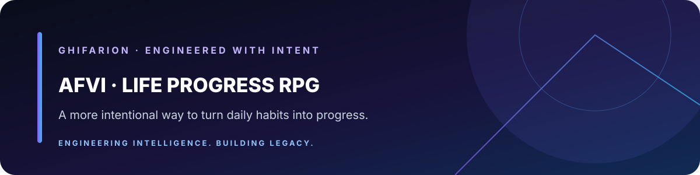

# aFVi — Life Progress RPG Landing Page

A static landing page introducing aFVi, a life-progress RPG concept built around habits, quests, and personal growth.

> **Ghifarion** · Engineering Intelligence. Building Legacy.

## On this page

- [Live experience](#live-experience)
- [Project overview](#project-overview)
- [Local development](#local-development)
- [Deployment](#deployment)

---

## Konten dan metadata

Halaman berisi pengenalan produk, CTA menuju aplikasi utama, metadata SEO dan social sharing, structured data, serta FAQ. Konten mengikuti prinsip proyek: jangan mengarang fitur, statistik, testimoni, atau screenshot yang belum diverifikasi.

## Deployment

Repository ini memiliki workflow GitHub Pages di [`.github/workflows/deploy-pages.yml`](./.github/workflows/deploy-pages.yml). Periksa tab **Actions** dan pengaturan **Pages** repository jika deployment tidak diperbarui. Canonical URL, Open Graph URL, dan sitemap ditujukan ke alamat GitHub Pages di atas.

## Pengembangan

Karena landing page saat ini berupa HTML statis, tidak ada langkah build atau package installation yang diperlukan. Edit `index.html` dan uji di browser sebelum commit. Pastikan perubahan tetap responsif, bisa dinavigasi dengan keyboard, dan menghormati preferensi reduced motion bila animasi ditambahkan.
